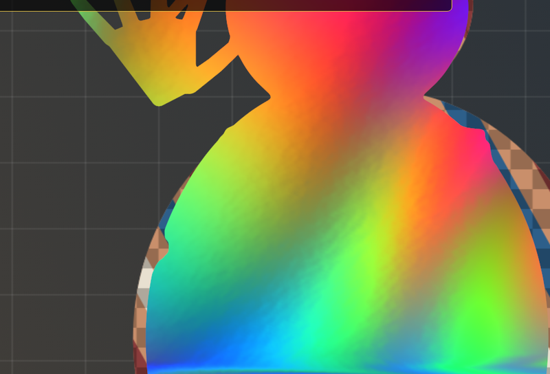
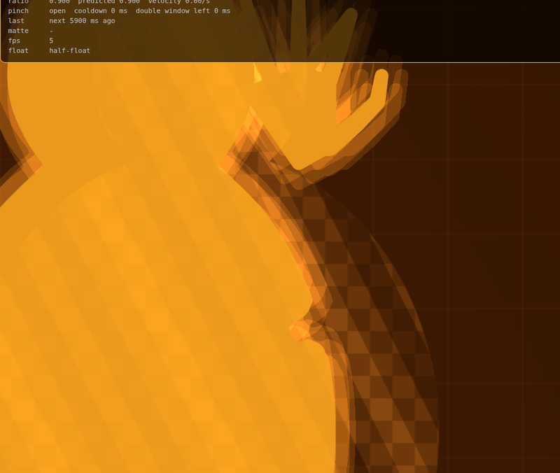

# webcam-body-fx

**[▶ Live demo — open and play](https://yibaili530-svg.github.io/webcam-body-fx/)** · [中文：点开就能玩](https://yibaili530-svg.github.io/webcam-body-fx/)

> Needs a camera + Chrome/Safari. First load downloads MediaPipe models from Google’s CDN. Use `?test=1` for a synthetic demo without a camera.

A webcam page that turns your silhouette into creative WebGL effects — all in the browser, nothing uploaded.

**Pinch** your thumb and index finger once to cycle effects. **Double-pinch** quickly to return to the normal camera view. Press **H** or the faint **ⓘ** button to hide or show the bottom info bar.





> Screenshots above use a synthetic QA fixture (not a real person).

## Effects

| Order | Effect | Notes |
| --- | --- | --- |
| 1 | Iridescent fluid | Slow flowing dye inside the silhouette |
| 2 | Slice reassembly | Sliding rectangular slices |
| 3 | Kaleidoscope | 8-sector radial mirror (~1.1× sample) |
| 4 | Ripple | Radial wavefronts from a body anchor |
| 5 | Code rain | Dense mono/duo glyph streams |
| 6 | Void | Warm amber silhouette with a soft glow |

Invisible click / keyboard fallbacks still exist at the old screen-edge positions if you prefer not to pinch.

## Privacy

- Camera stays on your device. No upload, no recording, `audio: false`.
- MediaPipe models load from Google’s public model CDN; the WASM runtime is copied locally on `npm install`.
- A Content-Security-Policy allows only same-origin connects plus `https://storage.googleapis.com` (and blocks MediaPipe usage metrics).

## Requirements

- A recent **Chrome** or **Safari** with WebGL
- A camera (the page uses the browser’s default / front camera)
- **HTTPS** or `localhost` (browsers require a secure context for `getUserMedia`)
- Decent lighting helps segmentation; results are never perfect

## Run locally

```sh
npm install   # also copies MediaPipe wasm into public/mediapipe/wasm
npm run dev   # http://localhost:5173
npm test
npm run build # output in dist/
```

Optional URL flags:

- `?diag=1` — small overlay with FPS and inference timings (not end-to-end latency)
- `?test=1` — synthetic video/mask/hands, no camera or models needed

## Controls

- **开始 (Start)** / stop — request or release the default camera
- **复位 (Reset)** — return to the normal camera view
- **Pinch once** — next effect (camera → fluid → slices → kaleidoscope → ripple → code → void → …)
- **Double-pinch** — back to the normal camera view
- **H** or **ⓘ** — hide / show the bottom info bar (remembered while the camera is running)

## Tech

- [Vite](https://vitejs.dev/) + vanilla JS
- WebGL fragment shaders for each effect
- [MediaPipe Tasks Vision](https://ai.google.dev/edge/mediapipe/solutions/vision/image_segmenter) — selfie segmentation, hand landmarker, optional pose landmarker (lite)
- Models are Apache-2.0; loaded from the official MediaPipe CDN (not vendored in this repo)

## Limitations (honest)

- Segmentation is approximate (256 px mask class, ordinary backgrounds — no green screen). Hands and edges can fray or leave gaps.
- There is **no claim of zero latency**. Display lag is camera capture + inference + the next frame.
- Frame rate depends on your GPU; low-end devices may run slowly.
- Pose assist is opportunistic and may skip frames when the scheduler is busy.

## 中文简介

**[▶ 在线演示（点开就能玩）](https://yibaili530-svg.github.io/webcam-body-fx/)**

打开摄像头后，用拇指和食指**捏合一次**切换效果（虹彩流体 → 切片重组 → 万花筒 → 涟漪 → 代码雨 → 虚空剪影），**快速捏合两次**回到正常画面。按 **H** 或右下角 **ⓘ** 可隐藏/显示底部信息。

画面只在浏览器本地处理，不上传、不录音。需要 Chrome / Safari（支持 WebGL）和摄像头；请在光线较好的环境使用。人像分割不是完美的，也不宣称零延迟。

```sh
npm install
npm run dev
```

## License

MIT © 2026 yibaili530-svg

(You can change the license later if you prefer something else.)
