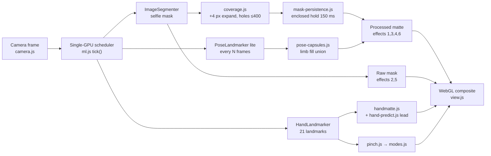

# webcam-body-fx

**[▶ Live demo — open and play](https://yibaili530-svg.github.io/webcam-body-fx/)**

> Needs a camera + Chrome/Safari on a desktop. First load downloads MediaPipe models from Google’s CDN. Use `?test=1` for a synthetic demo without a camera.

---

## How to play (quick start)

1. Open the **live demo** in desktop **Chrome** or **Safari**.
2. Click **Start** and allow the camera (default / front camera only).
3. Stand so your **upper body** is in frame; good light helps.
4. **Pinch** thumb + index finger once to cycle:
   **fluid → slices → kaleidoscope → ripple → code rain → void (glow silhouette) → …**
5. **Quick double-pinch** (second pinch within ~350 ms) returns to the normal camera view.
6. Press **H** or the faint **ⓘ** to hide/show the bottom info bar (handy while recording).
7. Everything stays **local** in your browser — no upload, no recording, `audio: false`.

Invisible click / keyboard fallbacks still exist at the old screen-edge positions if you prefer not to pinch.

---

## How it works (from the code)

Pipeline (one render frame):



### Mask & body

- **Segmenter** (`ml.js`): MediaPipe selfie / person confidence mask. Display work runs at mask resolution with short side **256** (`MATTE_SHORT_SIDE` in `view.js`).
- **Coverage** (`coverage.js`): Euclidean max-dilation of **`COVERAGE_RADIUS = 4`** mask pixels, then fill enclosed background components of at most **`COVERAGE_MAX_HOLE = 400`** pixels.
- **Persistence** (`mask-persistence.js`): dropped person pixels are held up to **`PERSIST_HOLD_MS = 150`** only when enclosed within **`PERSIST_ENCLOSE = 8`** mask pixels on all four sides (no trailing-edge ghost).
- **Which mask**: slices + code rain use the **raw** segmenter mask; fluid, kaleidoscope, ripple, void use the **expanded + persisted** coverage (plus hand matte / pose).
- **Pose assist** (`pose-capsules.js`): optional lite pose landmarks painted as capsules into the processed coverage. Scheduler stride starts at **`POSE_BASE_STRIDE = 3`**, slows to 6 / 12, or skips and re-probes every **`POSE_PROBE_FRAMES = 60`**.

### Hands & pinch

- **Hand matte** (`handmatte.js`) rasterizes finger chains; **display-only** lead from `hand-predict.js`: horizon `min(50 ms, sampleAge + 20 ms)`, gain ≤ **0.65**, lead capped at **2%** of the frame short side, fades **60→100 ms**, zero after 100 ms. Gesture code never reads this predictor.
- **Pinch** (`pinch.js`): distance thumb tip (**4**) → index tip (**8**), divided by wrist (**0**) → middle MCP (**9**). Closes below **`PINCH_CLOSE = 0.3`**, re-arms only after opening above **`PINCH_OPEN = 0.5`**. Early-fire when approaching faster than **1.0** ratio/s (not decelerating by more than half), change capped at **0.12**, unused after **100 ms**. **`PINCH_REFRACTORY_MS = 140`** lockout; **`DOUBLE_WINDOW_MS = 350`** in `modes.js` cancels to camera.

### Scheduler

`ml.js` runs **one** queued inference task at a time on the GPU (CPU fallback if GPU delegate fails). Per video frame: hands and segmentation **alternate**; pose runs after that frame’s pair when owed.

### Effects (WebGL in `view.js`)

Shared tempo **`RIP_W = EFFECT_TEMPO = 14` rad/s** (~0.449 s period) from `tempo.js` — except **fluid**, which keeps its own slow dye advection in `fluid.js` (curl of an analytic streamfunction; scaling it to 14 rad/s aliased to static).

| # | Mode | What it does |
| --- | --- | --- |
| 1 | Fluid | Screen-space iridescent dye advected in a divergence-free vortex field (`fluid.js`) |
| 2 | Slices | 10-row deforming grid; cell edges/content shift with frequencies scaled to `EFFECT_TEMPO` (`slices.js`) |
| 3 | Kaleidoscope | **8**-sector radial fold, fixed **`KAL_MAG = 1.1`** sample scale |
| 4 | Ripple | Radial sine rings from the body anchor; phase uses **`RIP_W = 14`** |
| 5 | Code rain | Dense glyph grid; mono/duo palettes + glint at `EFFECT_TEMPO` (`digital.js` / `glyphs.js`) |
| 6 | Void | Warm amber whole-frame grade; flat yellow-orange fill + halo (`VOID_HALO_R = 0.03`, pulse at `RIP_W`) (`void.js`) |

Honest limits: ordinary backgrounds only (no green screen), approximate edges, **no claim of zero latency**.

---

A webcam page that turns your silhouette into creative WebGL effects — all in the browser, nothing uploaded.


> Screenshots above use a synthetic QA fixture (not a real person).

## Effects

| Order | Effect | Notes |
| --- | --- | --- |
| 1 | Iridescent fluid | Slow flowing dye inside the silhouette |
| 2 | Slice reassembly | Sliding rectangular slices |
| 3 | Kaleidoscope | 8-sector radial mirror (~1.1× sample) |
| 4 | Ripple | Radial wavefronts from a body anchor |
| 5 | Code rain | Dense mono/duo glyph streams |
| 6 | Void | Warm amber silhouette with a soft glow |

## Privacy

- Camera stays on your device. No upload, no recording, `audio: false`.
- MediaPipe models load from Google’s public model CDN; the WASM runtime is copied locally on `npm install`.
- A Content-Security-Policy allows only same-origin connects plus `https://storage.googleapis.com` (and blocks MediaPipe usage metrics).

## Requirements

- A recent **Chrome** or **Safari** with WebGL
- A camera (the page uses the browser’s default / front camera)
- **HTTPS** or `localhost` (browsers require a secure context for `getUserMedia`)
- Decent lighting helps segmentation; results are never perfect

## Run locally

```sh
npm install   # also copies MediaPipe wasm into public/mediapipe/wasm
npm run dev   # http://localhost:5173
npm test
npm run build # output in dist/
```

Optional URL flags:

- `?diag=1` — small overlay with FPS and inference timings (not end-to-end latency)
- `?test=1` — synthetic video/mask/hands, no camera or models needed

## Controls

- **Start** / **Stop** — request or release the default camera
- **Reset** — return to the normal camera view
- **Pinch once** — next effect (camera → fluid → slices → kaleidoscope → ripple → code → void → …)
- **Double-pinch** — back to the normal camera view
- **H** or **ⓘ** — hide / show the bottom info bar (remembered while the camera is running)

## Tech

- [Vite](https://vitejs.dev/) + vanilla JS
- WebGL fragment shaders for each effect
- [MediaPipe Tasks Vision](https://ai.google.dev/edge/mediapipe/solutions/vision/image_segmenter) — selfie segmentation, hand landmarker, optional pose landmarker (lite)
- Models are Apache-2.0; loaded from the official MediaPipe CDN (not vendored in this repo)

## Limitations (honest)

- Segmentation is approximate (256 px mask class, ordinary backgrounds — no green screen). Hands and edges can fray or leave gaps.
- There is **no claim of zero latency**. Display lag is camera capture + inference + the next frame.
- Frame rate depends on your GPU; low-end devices may run slowly.
- Pose assist is opportunistic and may skip frames when the scheduler is busy.

## License

MIT © 2026 yibaili530-svg

(You can change the license later if you prefer something else.)
